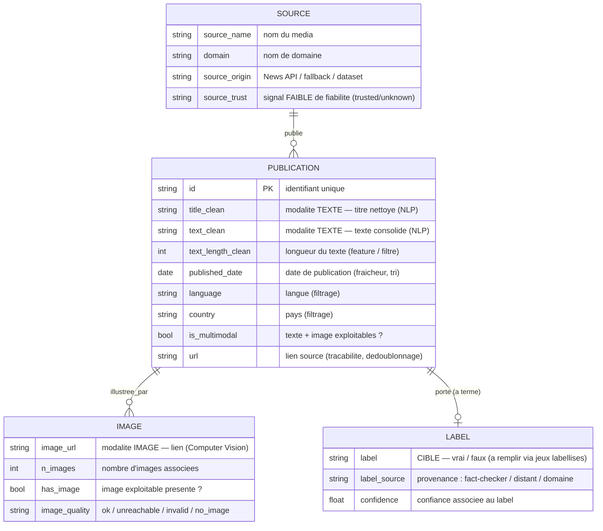

# Schéma conceptuel de données — CheckIt.AI
### Livrable 3 (partie schéma) — modèle **conceptuel** (métier), indépendant de toute technologie

> ⚠️ Ceci est un **modèle conceptuel** (entités, attributs, relations, rôles métier), **pas** un schéma physique/SQL
> (tables, index, clés étrangères). Il décrit *ce que signifient* les données et *à quoi elles servent* pour l'IA,
> sans préjuger de leur stockage.

---

## 1. Diagramme entités-relations (Mermaid)

---

## 2. Rôle des entités dans le cas d'usage IA

| Entité | Rôle pour le détecteur de fake news |
|---|---|
| **PUBLICATION** | Entité centrale : une publication = une unité d'apprentissage (texte + image + métadonnées). |
| **SOURCE** | Provenance de la publication ; fournit un **signal faible** de fiabilité (`source_trust`). |
| **IMAGE** | Porte la **modalité visuelle** ; alimente un encodeur image (ex. CNN/ResNet). |
| **LABEL** | **Cible** de la classification supervisée ; vide pour l'instant, à remplir via Fakeddit / FakeNewsNet. |

---

## 3. Dictionnaire des champs (types conceptuels + rôle)

| Champ | Type conceptuel | Modalité / rôle | Origine |
|---|---|---|---|
| `id` | identifiant | clé unique | généré à l'extraction |
| `url` | lien | traçabilité, dédoublonnage | source |
| `source_origin` | catégoriel | provenance technique | pipeline |
| `source_name` | texte court | provenance (média) | source |
| `domain` | texte court | provenance → base du signal de fiabilité | dérivé de `url` |
| `title_clean` | texte | **modalité texte** (NLP) | nettoyage |
| `text_clean` | texte | **modalité texte** (NLP : embeddings) | nettoyage (titre+desc+contenu) |
| `text_length_clean` | numérique | feature / filtre qualité | calculé |
| `image_url` | lien | **modalité image** (Computer Vision) | source |
| `n_images` | numérique | richesse visuelle | calculé |
| `has_image` | booléen | éligibilité multimodale | validation image |
| `image_quality` | catégoriel | contrôle qualité image | validation image |
| `published_date` | date | fraîcheur, tri, dédoublonnage | normalisé |
| `language`, `country` | catégoriel | filtrage / cohérence | source |
| `source_trust` | catégoriel | **signal faible** de fiabilité (≠ label) | dérivé de `domain` |
| `is_multimodal` | booléen | filtre d'éligibilité (texte + image) | calculé |
| `label` | catégoriel | **cible** (vrai/faux) | jeux labellisés (à venir) |
| `label_source` | catégoriel | fiabilité du label | jeux labellisés |
| `confidence` | numérique | confiance du label | jeux labellisés |

---

## 4. Points de conception (pour la soutenance)

- **Séparation modalités / métadonnées / cible :** le schéma isole clairement le **texte** (NLP), l'**image** (CV), les
  **métadonnées** (filtrage/traçabilité) et le **label** (cible), ce qui cadre directement l'architecture d'un modèle
  multimodal.
- **`source_trust` n'est pas un label :** c'est un **signal faible** de fiabilité de la source. On ne confond pas une
  source peu fiable avec une information fausse (cf. distinction opinion controversée / désinformation).
- **`label` volontairement vide :** l'acquisition en flux ne fournit pas de vérité terrain. Le label sera apporté par
  les jeux labellisés (Fakeddit, FakeNewsNet), d'où la relation *0..1* entre PUBLICATION et LABEL.
- **Association texte/image garantie :** `is_multimodal` matérialise l'exigence « texte **et** image dans la même
  entrée ».
