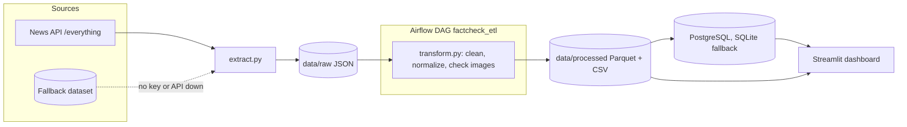

# CheckIt.AI · Multimodal data pipeline for fake news detection

An end-to-end data pipeline that collects **news posts with text and image**, validates the text-image pairing, cleans and normalizes the data, and loads it into PostgreSQL through an **Airflow ETL**. A Streamlit dashboard tracks the quality, freshness and volume of the collected data. The goal is to build a reliable training corpus for a multimodal fake news detector.


---

## What it does

| Stage | Folder | Output |
|---|---|---|
| 1. Source exploration | `01_exploration/` | Comparative report on 7 sources: news APIs, RSS, Reddit and labeled datasets (Fakeddit, FakeNewsNet) |
| 2. Extraction | `02_extraction/` | News API `/everything` with fallback dataset → raw JSON in `data/raw/` |
| 3. Transformation | `03_transformation/` | Cleaning, normalization, image validation → `dataset.parquet` + `dataset.csv` |
| 4. Orchestration | `04_orchestration/` | Airflow DAG `factcheck_etl` loading PostgreSQL, in Docker Compose |
| 5. Monitoring | `05_dashboard/` | Streamlit dashboard and monitoring plan |

**Data quality checks on a demo run (19 publications, 13 domains):** 94.7% truly multimodal (text and reachable image), 1 unreachable image detected and flagged, 21.1% from trusted sources.

---

## Architecture



### Data model

Every record must carry the four required fields **text, image, date and source** in the same entry. A post without a reachable image is not multimodal and is flagged during validation.

| Field | Role |
|---|---|
| `id`, `title` / `content`, `image_urls`, `published_at` | Required |
| `url`, `source_name` / `domain` | Traceability, deduplication, source reliability |
| `language`, `country`, `category` | Filtering and segmentation |
| `has_image`, `image_quality` | Image modality quality control |
| `source_trust` | Weak reliability signal for the source |

`source_trust` is **not** a true / false label. Ground truth labels come from fact-checked or labeled datasets (Fakeddit, FakeNewsNet), kept separate from real-time acquisition.

### Architecture decisions

- **AD-1 · Reliable endpoint:** News API `/everything` with keywords and `language=fr`, because `top-headlines?country=fr` often returns 0 results.
- **AD-2 · Graceful fallback:** every external dependency has a fallback (News API → fallback dataset, PostgreSQL → SQLite), so a service outage never breaks the pipeline.
- **AD-3 · Separate flows:** labeled ground truth ingestion is kept apart from real-time acquisition, which has weaker labels.
- **AD-4 · Two storage layers:** immutable `raw` in JSON to ingest without loss, typed `processed` in Parquet for training and analytics (CSV for human inspection).

---

## Quick start

Requires Python 3.11+ and Docker. A News API key is optional: without it, extraction uses the fallback dataset.

```bash
git clone https://github.com/DagueG/FactCheck.git
cd FactCheck
python -m venv .venv
source .venv/bin/activate              # Windows: .venv\Scripts\activate
pip install -r requirements-base.txt -r requirements-dashboard.txt
echo "API_KEY_NEWS_API=your_key" > .env
```

### 1. Extract

```bash
python 02_extraction/extract.py --query "France OR sante OR desinformation" --language fr --page-size 10
```

The log shows the data origin (`News API` or the fallback dataset). Output in `data/raw/`.

### 2. Transform

```bash
python 03_transformation/transform.py
```

Output: `data/processed/dataset.csv` and `data/processed/dataset.parquet`. Delete any `etl_articles.json` left over from an Airflow run first.

### 3. Run the Airflow ETL

```bash
cd 04_orchestration
docker compose up -d
```

Open http://localhost:8080 (local default credentials `admin` / `admin`), unpause and trigger the `factcheck_etl` DAG. The run reaches `success` in about 30 seconds, then the `publications` table in PostgreSQL contains the loaded posts.

```bash
docker compose down        # stop, keep data
docker compose down -v     # stop and remove volumes
```

### 4. Dashboard

```bash
streamlit run 05_dashboard/app.py      # http://localhost:8501
```

KPIs on data precision (multimodal share, trusted sources, images, text length, domains, languages) and distributions of source reliability and image quality.

---

## Project structure

```
FactCheck/
├── 01_exploration/            # source exploration report
├── 02_extraction/             # News API extraction with fallback
├── 03_transformation/         # cleaning and normalization, Mermaid schema
├── 04_orchestration/          # Airflow DAG, docker-compose (PostgreSQL)
├── 05_dashboard/              # Streamlit dashboard, monitoring plan
├── data/                      # raw/ (JSON), processed/ (Parquet, CSV), fallback/
├── docs/captures/             # screenshots
├── requirements-*.txt         # dependencies split by stage (base, etl, dashboard, dev)
└── rapport_exploration_sources.md
```

## Limitations and next steps

- Demo runs use a small volume and a single language (French).
- Real-time sources carry no true / false label: the next step is to ingest Fakeddit (text + image, 2 / 3 / 6-way labels) and FakeNewsNet (fact-checked labels) as ground truth.
- Add The Guardian API, NewsData.io and RSS feeds as additional sources in the fallback chain.
- Train and evaluate the multimodal detector on the resulting corpus.

---

*Built by [Daniel Guedj](https://www.linkedin.com/in/daniel-guedj) · AI engineer · LLM, AI agents and process automation in production.*
